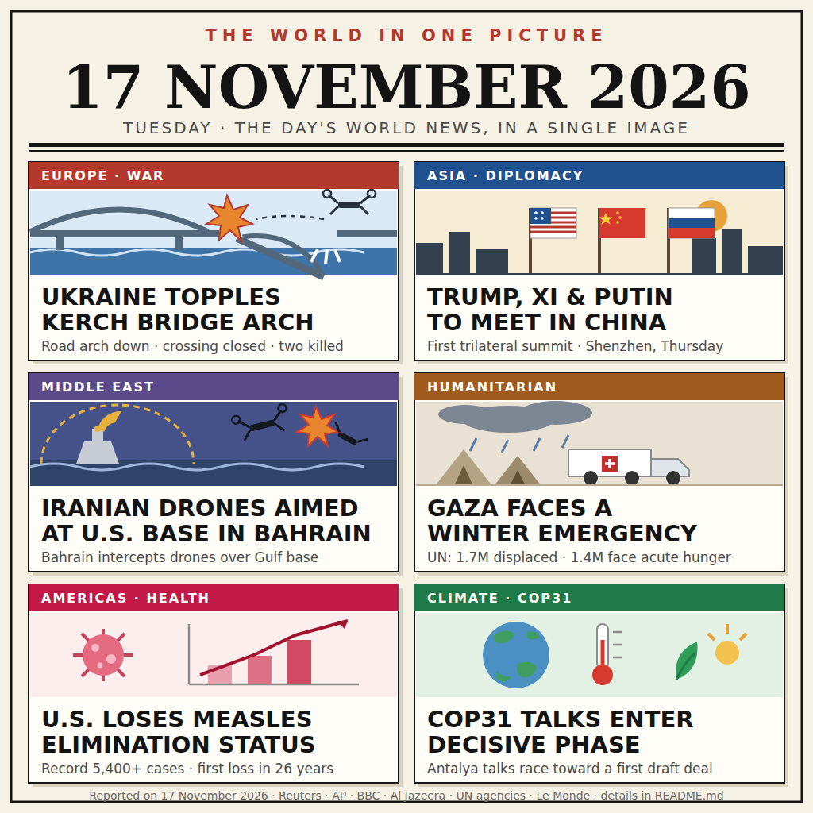

# 17 November 2026 — The World in One Picture

An entry for the make.fun competition
[news-image-20261117](https://make.fun/c/news-image-20261117/kit) —
“Sum up 17 November's world news in one image.”

One front-page collage sums up **Tuesday 17 November 2026**: six of the day's
most consequential stories, each drawn and labelled, under the day's date.

## The stories in the picture

1. **Ukraine topples the Kerch Bridge arch** — A Ukrainian missile-and-drone
   strike, the second in two days inside a record 1,441-drone barrage, dropped
   the road arch of the bridge linking Russia to occupied Crimea into the
   Kerch Strait; two people were killed and road traffic was suspended.
2. **Trump, Xi & Putin to meet in China** — The US, Chinese and Russian
   presidents are set to hold their first trilateral meeting on Thursday
   19 November in Shenzhen, on the sidelines of the APEC summit.
3. **Iranian drones aimed at a U.S. base in Bahrain** — Bahrain's air defences
   intercepted Iranian drones targeting the American military radar site at
   Sheikh Isa air base, home to the US Fifth Fleet.
4. **Gaza faces a winter emergency** — UN agencies (WFP, IOM) warned that more
   than 1.7 million people remain displaced and about 1.4 million face acute
   hunger as winter closes in; the UK, Australia, Canada and Italy urged
   Israel to open the crossings to aid.
5. **U.S. loses measles elimination status** — After 26 years, amid record
   numbers — more than 5,400 cases and 10 deaths this year, the worst since
   the early 1990s.
6. **COP31 talks enter a decisive phase** — The climate conference in Antalya,
   Türkiye, moved into its decisive stage, with negotiators working on the
   first draft of a possible agreement.

## Sources (reporting of 17 November 2026)

- World News Digest: Top Stories of November 17, 2026 — https://asaspress.com/en/news/world-news-digest-top-stories-of-november-17-2026
- Ukraine Strikes Section of Russia's Crimean Bridge Two Days Before Putin Meets Trump, Xi (Military.com / Bloomberg) — https://www.military.com/ukraine-strikes-section-of-russias-crimean-bridge-two-days-before-putin-meets-trump-xi
- How Ukraine succeeded in destroying part of Putin's Crimean bridge (Le Monde) — https://www.lemonde.fr/en/international/article/2026/11/17/how-ukraine-succeeded-in-destroying-part-of-putin-s-crimean-bridge_6782830_4.html
- Ukraine Hits Crimea Bridge in 1,441-Drone Barrage (The Apex Wire) — https://theapexwire.com/world-news/ukraine-strikes-crimea-bridge-drone-barrage/
- AI CHAT World News 17/11/2026 (Human Synthesis — Al Jazeera, Reuters, AA links) — https://human-synthesis.ghost.io/2026/11/17/ai-chat-world-news-17-11-2026/
- Morning world news summary for November 17 (Summarized News — Al Jazeera links) — https://summarizednews.com/2026/11/17/morning-world-news-summary-for-november-17/
- BBC world & top stories, 17–18 Nov 2026 — https://www.arjenholterman.nl/?page_id=1089

## How it works

- `artwork.svg` — the original vector artwork (a newspaper front page for the day).
- `image.png` — the rendered entry image: 1024×1024 PNG, 160,035 bytes
  (gate: a whole PNG of at most 1 MiB and 1024×1024).
- `main.py` — the entry program (Python 3.13, standard library only). It runs
  offline and copies `image.png` to `/output/entry.png`, byte for byte, so
  both grading runs produce identical output:
  `mkdir -p out && MAKEFUN_OUTPUT_DIR=out python3 main.py`
- `index.html` — a single-page presentation of the image with a caption for
  each story depicted.
- `LICENSE` — MIT (see the SPDX line at its top).
